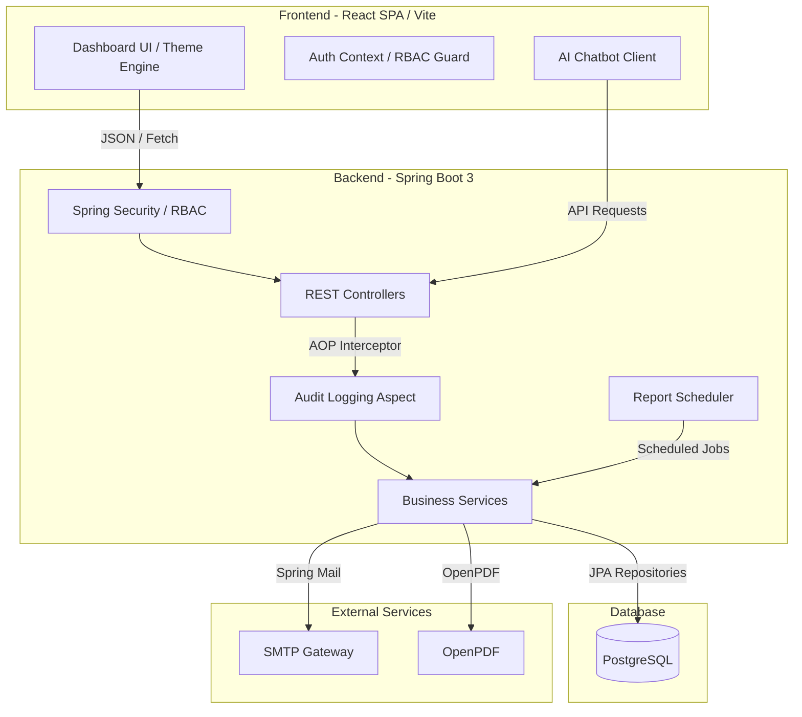

# SentinelCore-SecureOps

## Cloud Security Monitoring System with Incident Management Assistance

SentinelCore-SecureOps is a production-grade **Security Operations (SecOps) orchestration platform** designed to help Security Operations Centers (SOCs) monitor, manage, and respond to security threats, incidents, vulnerabilities, compliance requirements, and infrastructure metrics.

The platform provides a modern **React Single Page Application (SPA)** frontend integrated with a secure **Spring Boot 3 backend** and **PostgreSQL database**. It implements role-based access control (RBAC), incident management, vulnerability tracking, audit logging, automated reporting, email notifications, and an AI-powered SecOps assistant.

---

## 🚀 Live Deployment

### 🌐 Deployed Application

**SentinelCore-SecureOps:**
https://sentinel-core-secure-ops-f7k2.vercel.app/login

The deployed frontend provides access to the SentinelCore-SecureOps security operations dashboard.

> **Note:** The application requires valid backend services and database connectivity for all features to operate correctly.

### 🔐 Default Development Credentials

For local development/testing:

```text
Username: admin
Password: admin123
Role: ROLE_SUPER_ADMIN
```

> ⚠️ These are default development credentials. Change or disable them before using the application in a production environment.

---

# 🚀 Key Features

## 📊 Executive Dashboard

Provides real-time aggregation of important security and infrastructure metrics, including:

* Total enrolled assets
* Active security incidents
* Critical CVE vulnerabilities
* Security alerts
* Audit records
* Incident status statistics
* Incident severity statistics
* Incident trend information
* Recent incidents and alerts

---

## 🖥️ Asset Management

Provides complete CRUD operations for managing infrastructure assets such as:

* Endpoints
* Databases
* Servers
* Network firewalls

The system supports:

* Unique IP address validation
* Asset creation
* Asset modification
* Asset deletion
* Asset status tracking
* CPU telemetry
* Memory telemetry
* Disk telemetry
* Network telemetry

---

## 🚨 Incident Response Management

The Incident Response Queue provides a structured workflow for managing security incidents.

Features include:

* Custom incident ticket codes such as `INC-889`
* Severity classification:

  * Critical
  * High
  * Medium
  * Low
* SLA monitoring
* Technician assignment
* Incident status tracking:

  * Open
  * Investigating
  * Resolved
* Incident creation
* Incident management
* Incident resolution
* Incident deletion

---

## 🛡️ Vulnerability Tracking

The platform maintains a repository of active CVE vulnerabilities.

Features include:

* CVE vulnerability tracking
* Host-to-vulnerability correlation
* Severity information
* Remediation instructions
* Vulnerability management
* Automated patch deployment actions

---

## 📋 Compliance Posture Management

The system provides an operational compliance dashboard supporting security standards such as:

* ISO/IEC 27001:2022
* SOC 2 Type II
* PCI DSS v4.0

---

## 📝 Audit Logging

SentinelCore-SecureOps implements passive audit tracing using **Spring Aspect-Oriented Programming (AOP)**.

The system automatically records important application actions through auditable controller checkpoints.

The audit system also handles long User-Agent strings by truncating them before storing them in the database.

---

## 🤖 AI SecOps Assistant

The platform includes an interactive AI assistant that helps users navigate and understand the security operations dashboard.

Example queries include:

```text
How do I add a new asset?
```

The assistant can guide users through relevant dashboard operations and workflows.

---

## 📄 Automated PDF Reports

The system provides automated security report generation using **OpenPDF**.

Features include:

* PDF report generation
* Report templates
* Scheduled report execution
* Security and operational reporting

The application uses a `ReportScheduler` for scheduled report execution.

---

## 📧 SMTP Email Notifications

The platform integrates with SMTP services to send notifications for:

* Security alerts
* Critical incidents
* System events

---

# 🏗️ System Architecture



---

# 🛠️ Technology Stack

## Backend

| Technology        | Purpose                          |
| ----------------- | -------------------------------- |
| Java 17           | Backend programming language     |
| Spring Boot 3.4.7 | Backend framework                |
| Spring Security 6 | Authentication and authorization |
| Spring Data JPA   | Database persistence             |
| Hibernate         | ORM                              |
| PostgreSQL        | Relational database              |
| Spring AOP        | Audit logging                    |
| Spring Mail       | Email notifications              |
| OpenPDF 2.0.3     | PDF generation                   |
| Maven             | Dependency management and build  |

---

## Frontend

| Technology          | Purpose                      |
| ------------------- | ---------------------------- |
| React               | User interface               |
| Vite                | Frontend build tool          |
| React Router DOM    | Client-side routing          |
| React Context API   | Authentication/global state  |
| JavaScript          | Frontend logic               |
| CSS                 | Responsive UI and animations |
| SweetAlert2         | Authorization alerts         |
| Toast Notifications | User feedback                |

---

# 🔐 Security & Role-Based Access Control

SentinelCore-SecureOps implements granular **Role-Based Access Control (RBAC)**.

The platform defines:

* **19 distinct permissions**
* **9 enterprise operational roles**

Authorization is enforced through **Spring Security** and `@PreAuthorize` guards.

---

## 🔑 Permissions

### Authentication & Auditing

```text
AUDIT_VIEW
```

### User Administration

```text
USER_MANAGE
ROLE_ASSIGN
```

### Asset Management

```text
ASSET_VIEW
ASSET_CREATE
ASSET_EDIT
ASSET_DELETE
```

### Incident Management

```text
INCIDENT_VIEW
INCIDENT_CREATE
INCIDENT_MANAGE
INCIDENT_RESOLVE
INCIDENT_DELETE
```

### Threat Intelligence & Infrastructure

```text
SERVER_RESTART
CLUSTER_SCALE
CLOUD_MODIFY
VULN_MANAGE
COMPLIANCE_VIEW
```

### Reporting & Configuration

```text
REPORT_EXPORT
SETTINGS_ACCESS
INTEGRATION_CONFIG
```

---

# 👥 User Roles

## 1. ROLE_SUPER_ADMIN

Full system access with all available permissions.

---

## 2. ROLE_ADMIN

Responsible for:

* User administration
* System configuration
* Core administrative operations

---

## 3. ROLE_SOC_MANAGER

Responsible for security operations oversight.

Permissions include:

```text
ASSET_VIEW
INCIDENT_*
REPORT_EXPORT
AUDIT_VIEW
```

---

## 4. ROLE_SECURITY_ANALYST

Responsible for security threat detection and analysis.

Permissions include:

```text
ASSET_VIEW
INCIDENT_VIEW
INCIDENT_CREATE
INCIDENT_MANAGE
VULN_MANAGE
REPORT_EXPORT
```

---

## 5. ROLE_INCIDENT_RESPONDER

Responsible for incident remediation.

Permissions include:

```text
ASSET_VIEW
INCIDENT_VIEW
INCIDENT_MANAGE
INCIDENT_RESOLVE
AUDIT_VIEW
```

---

## 6. ROLE_INFRA_ENGINEER

Responsible for infrastructure and hardware operations.

Permissions include:

```text
ASSET_VIEW
ASSET_CREATE
ASSET_EDIT
ASSET_DELETE
INCIDENT_VIEW
SERVER_RESTART
CLUSTER_SCALE
CLOUD_MODIFY
REPORT_EXPORT
```

---

## 7. ROLE_DEVSECOPS

Responsible for security and continuous compliance operations.

Permissions include:

```text
ASSET_VIEW
ASSET_CREATE
ASSET_EDIT
INCIDENT_VIEW
INCIDENT_CREATE
INCIDENT_MANAGE
VULN_MANAGE
SERVER_RESTART
CLUSTER_SCALE
REPORT_EXPORT
```

---

## 8. ROLE_AUDITOR

Responsible for security and compliance auditing.

Permissions include:

```text
ASSET_VIEW
INCIDENT_VIEW
AUDIT_VIEW
COMPLIANCE_VIEW
REPORT_EXPORT
```

---

## 9. ROLE_VIEWER

Read-only access to:

```text
ASSET_VIEW
INCIDENT_VIEW
```

---

# 🗄️ Database Models

The application uses JPA entities to represent the core security operations data.

### User

Stores:

* User account information
* Profile settings
* Theme
* Language
* Timezone
* Last login
* Active status

### Role

Stores roles assigned to users and their associated permissions.

### Permission

Represents individual authorization permissions.

### Asset

Stores infrastructure assets and telemetry information.

### Incident

Stores security incidents including:

* Severity
* SLA
* Technician assignment
* Status
* Incident details

### Vulnerability

Stores CVE vulnerability information and remediation references.

### AuditLog

Stores automatically generated audit records.

### Alert

Stores real-time security alerts and severity information.

---

# 📡 REST API Endpoints

| Endpoint                            | Method | Authority     | Description                                |
| ----------------------------------- | ------ | ------------- | ------------------------------------------ |
| `/api/users/register`               | POST   | Public        | Registers a new user                       |
| `/api/users`                        | GET    | USER_MANAGE   | Retrieves users                            |
| `/api/users/{id}/role`              | PUT    | ROLE_ASSIGN   | Updates user role                          |
| `/api/users/{id}/disable`           | PUT    | USER_MANAGE   | Enables/disables user                      |
| `/api/users/{id}/reset-password`    | PUT    | USER_MANAGE   | Resets user password                       |
| `/api/users/profile`                | PUT    | Authenticated | Updates user profile                       |
| `/api/assets`                       | GET    | ASSET_VIEW    | Retrieves assets                           |
| `/api/assets/{id}`                  | GET    | ASSET_VIEW    | Retrieves asset details                    |
| `/api/assets`                       | POST   | ASSET_CREATE  | Creates an asset                           |
| `/api/assets/{id}`                  | PUT    | ASSET_EDIT    | Updates an asset                           |
| `/api/assets/{id}`                  | DELETE | ASSET_DELETE  | Deletes an asset                           |
| `/api/dashboard/stats`              | GET    | Authenticated | Retrieves dashboard statistics             |
| `/api/dashboard/incidents/status`   | GET    | Authenticated | Retrieves incident status counts           |
| `/api/dashboard/incidents/severity` | GET    | Authenticated | Retrieves incident severity counts         |
| `/api/dashboard/incidents/trend`    | GET    | Authenticated | Retrieves incident trends                  |
| `/api/dashboard/incidents/recent`   | GET    | Authenticated | Retrieves recent incidents                 |
| `/api/dashboard/alerts/recent`      | GET    | Authenticated | Retrieves recent alerts                    |
| `/api/dashboard/audit-logs/recent`  | GET    | Authenticated | Retrieves recent audit logs                |
| `/api/dashboard/user`               | GET    | Authenticated | Retrieves current user                     |
| `/api/ai/chat`                      | POST   | Public        | Sends a message to the AI SecOps assistant |

---

# ⚙️ Local Installation & Setup

## Prerequisites

Install the following:

* Java 17
* Maven
* Node.js
* npm
* PostgreSQL
* Git

---

# 🗄️ PostgreSQL Setup

Create a PostgreSQL database:

```sql
CREATE DATABASE sentinelcore;
```

The backend expects PostgreSQL to be available at:

```text
Host: localhost
Port: 5432
Database: sentinelcore
User: postgres
```

Configure your PostgreSQL password through the application's configuration or environment variables.

---

# 🚀 Running the Backend

Navigate to the project root:

```bash
mvn spring-boot:run
```

Alternatively:

```bash
run-server.bat
```

The backend runs on:

```text
http://localhost:8081
```

During startup, the application initializes:

* Database tables
* Default roles
* Permissions
* Initial records
* Administrative account

---

# 💻 Running the Frontend

Navigate to the frontend directory:

```bash
cd frontend
```

Install dependencies:

```bash
npm install
```

Start the development server:

```bash
npm run dev
```

The frontend normally runs on:

```text
http://localhost:5173
```

---

# 🔑 Default Local Login

```text
Username: admin
Password: admin123
Role: ROLE_SUPER_ADMIN
```

> ⚠️ For security reasons, do not use default credentials in a real production deployment.

---

# 🌐 Deployment

The frontend application is deployed and accessible online at:

**Live Application:**
https://sentinel-core-secure-ops-f7k2.vercel.app/login

The project architecture separates the frontend, backend, database, and external services so that each component can be independently configured and deployed.

For local development, the backend runs on port `8081` and the React/Vite frontend runs on port `5173`.

---

# 📁 Project Structure

```text
SentinelCore-SecureOps/
│
├── frontend/
│   ├── src/
│   ├── public/
│   ├── package.json
│   └── vite.config.js
│
├── src/
│   └── main/
│       ├── java/
│       │   └── ...
│       └── resources/
│           └── application.properties
│
├── pom.xml
├── run-server.bat
└── README.md
```

---

# 🔄 Application Workflow

```text
User
  │
  ▼
React Frontend
  │
  ▼
Authentication / RBAC
  │
  ▼
Spring Security
  │
  ▼
REST Controllers
  │
  ▼
Business Services
  │
  ├──► Incident Management
  ├──► Asset Management
  ├──► Vulnerability Management
  ├──► Compliance
  ├──► Audit Logging
  ├──► PDF Reports
  └──► Email Notifications
  │
  ▼
Spring Data JPA
  │
  ▼
PostgreSQL
```

---

# 🎯 Project Objectives

The main objectives of SentinelCore-SecureOps are to:

1. Centralize security operations monitoring.
2. Manage security incidents through structured workflows.
3. Monitor infrastructure assets.
4. Track vulnerabilities and remediation activities.
5. Implement granular role-based access control.
6. Maintain detailed audit trails.
7. Support compliance monitoring.
8. Generate automated security reports.
9. Provide email notifications for critical events.
10. Assist security teams through an AI-powered assistant.

---

# 🧪 Security Capabilities

The platform demonstrates several enterprise security concepts:

* Authentication
* Authorization
* RBAC
* Permission-based access control
* Audit logging
* Incident management
* Vulnerability management
* Compliance monitoring
* Security alerts
* Infrastructure monitoring
* Secure REST APIs

---

# 📈 Future Enhancements

Potential future improvements include:

* Real-time WebSocket-based security alerts
* SIEM integration
* Cloud provider integrations
* Advanced threat intelligence feeds
* Automated incident response playbooks
* ML-based anomaly detection
* Container/Kubernetes security monitoring
* Multi-factor authentication
* OAuth2/OpenID Connect integration
* Advanced security analytics dashboards

---

# 👨‍💻 Project Information

**Project:** SentinelCore-SecureOps
**Category:** Cloud Security / SecOps / Security Operations
**Architecture:** Full-Stack Web Application
**Backend:** Spring Boot 3 + Java 17
**Frontend:** React + Vite
**Database:** PostgreSQL
**Security:** Spring Security + RBAC
**Deployment:** Vercel frontend deployment

---

# 📜 License

This project is developed for educational, academic, and demonstration purposes.
